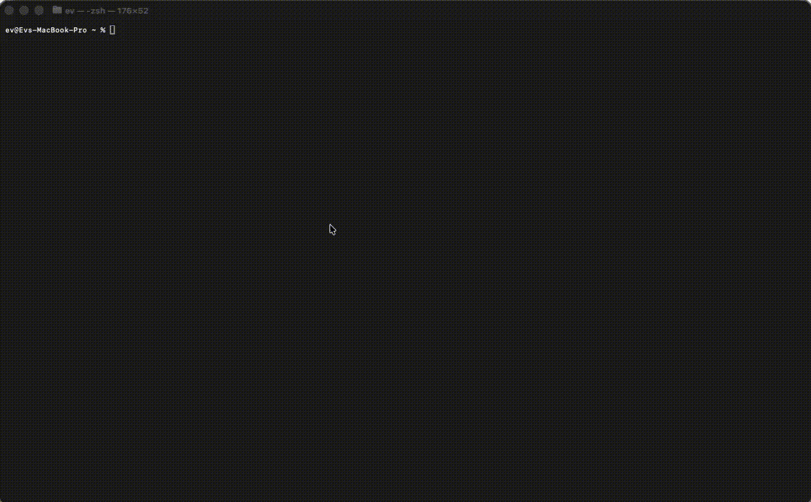

# ssh-cv

[](go.mod)
[](https://hub.docker.com/r/dmitryporotnikov/ssh-cv)

A tiny SSH server that shows your CV in the terminal. Someone runs `ssh -p 2222 any-user@your-host`, gets a short animation, reads your profile rendered with ANSI colors, and leaves. No shell, no commands, no SFTP, nowhere to go.

Live demo: `ssh dmitry.porotnikov.com`



## What it does

Listens on a configurable port and accepts anonymous sessions. Anything that isn't a session channel is refused. `info.md` is rendered with basic markdown and color, the host key survives restarts, and handshake timeouts, session timeouts and a connection cap keep scanners from piling up.

`info.md` is the content, `config.yaml` is optional, `ssh_host_key` gets generated on first run. Override the paths with `SSH_CV_CONFIG_PATH`, `SSH_CV_INFO_PATH` and `SSH_CV_HOST_KEY_PATH`.

## Run it

```bash
go run .
```

Port 2222 by default:

```bash
ssh -p 2222 any-user@localhost
```

## Docker

The image is `dmitryporotnikov/ssh-cv:latest`.

```bash
docker run -d --name ssh-cv -p 2222:2222 -v ssh-cv-data:/data dmitryporotnikov/ssh-cv:latest
```

To serve your own profile without rebuilding, put `config.yaml` and `info.md` in a directory on the host and mount it read-only:

```bash
mkdir -p "$HOME/ssh-cv-runtime"
docker run -d \
  --name ssh-cv \
  -p 2222:2222 \
  -e SSH_CV_CONFIG_PATH=/runtime/config.yaml \
  -e SSH_CV_INFO_PATH=/runtime/info.md \
  -e SSH_CV_HOST_KEY_PATH=/data/ssh_host_key \
  -v "$HOME/ssh-cv-runtime:/runtime:ro" \
  -v ssh-cv-data:/data \
  dmitryporotnikov/ssh-cv:latest
```

Config keys and defaults are in [config.yaml](config.yaml); every setting is optional. Restart the container after editing the mounted files, since content is read at startup.

Build locally with `docker build -t ssh-cv .`, or use [compose.yaml](compose.yaml) with `docker compose up --build`.
